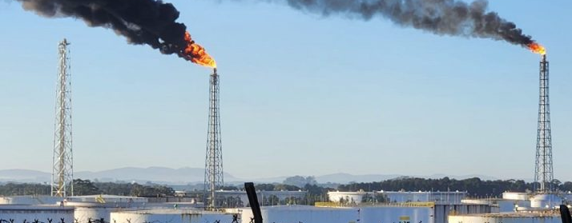
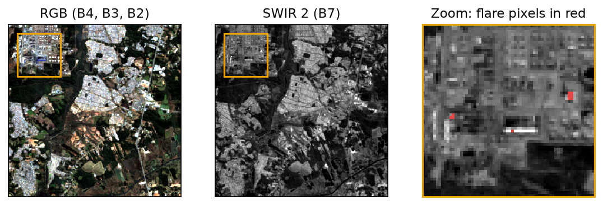

# **FlareSatFormer: Transformers and Foundation Models for Gas Flare Segmentation in Landsat 8 Imagery**

## Introduction

**FlareSatFormer** is a deep-learning project for **gas flare segmentation** in **Landsat 8** imagery. Oil and gas operations flare gas for safety reasons. At large scale, flaring is a significant source of greenhouse gas emissions, so it needs accurate and scalable monitoring.

<p align="center">
  
  <br>
  <em>Gas flaring at the REPAR (Refinaria Presidente Getúlio Vargas) facility in Araucária, Paraná, Brazil.</em>
</p>

Version 2.0 is a controlled comparison of a CNN baseline against transformers and an Earth-observation foundation model. Flares are **subpixel targets**: a 256 × 256 patch contains about 14 flare pixels (0.02%). The question is whether attention-based models help on targets this small, given a fair protocol.

It extends **FlareSat** (<https://github.com/marycamila184/flaresat>), which is the reference baseline.

<p align="center">
  
  <br>
  <em>A flare at the REPAR refinery seen by Landsat 8 (path/row 220/078). The SWIR 2 band (B7) shows the hot spot that the models segment.</em>
</p>

---

## Dataset

| Source | Patches | Mask | Used as |
|---|---|---|---|
| Gas flares | 11,505 | flare pixels | positives (83 countries, 6 continents) |
| Urban areas | 683 | empty | hard negatives (bright, reflective surfaces) |
| Wildfires | 265 | empty | hard negatives (other thermal sources) |

Each patch is 256 × 256 × 10 (float32 TOA reflectance), with bands **B1–B7, B9, B10, B11** in that order. The main experiments use **B2, B6, B7**. Prithvi is also tested with the six HLS bands B2–B7.

**Splits** (`splits/fold{1..4}.csv`, versioned):

- **Test folds:** flares are grouped by continent: Asia (4,570) | Africa (2,581) | Europe + Oceania (2,283) | Americas (2,071). Urban patches are grouped by city and wildfire patches by WRS-2 path/row.
- **Validation:** about 10% of each training fold, grouped by **path/row**. This keeps the same facility, seen on another date, out of both train and validation.

---

## Models

| Model | Encoder | Pretraining |
|---|---|---|
| UNet (baseline) | CNN, same architecture as FlareSat | none |
| SegFormer-B2 | MiT-B2 (Hugging Face `nvidia/mit-b2`) | ImageNet-1k |
| SegFormer-B2 (scratch) | MiT-B2 | none (pretraining control) |
| Swin-UNet | SwinV2-T, window 8 (`timm`) | ImageNet-1k |
| TransUNet | R50-ViT-B/16 hybrid (`timm`) | ImageNet-21k |
| Prithvi-EO-2.0-300M | ViT-L (`terratorch`), LoRA r=16 | HLS (NASA/IBM) |

Transformers downsample by 4–16× before attention, which can erase a 1–3 pixel flare. Every non-UNet model therefore uses the same **full-resolution head**: a shallow conv branch on the 256 × 256 input, fused with the decoder output. An ablation (SegFormer without the head) measures its effect.

---

## Protocol

- **Same recipe for every model:**
  - Loss: Focal (α_t = 0.25/0.75, γ = 2) plus batch-level Dice.
  - Optimizer: AdamW (wd 0.01), with 0.1× lr for pretrained encoders.
  - Schedule: 5% warmup, then cosine.
  - Up to 80 epochs, with early stopping (patience 15) on validation F1.
  - Effective batch size 16, bf16, flip/rot90 augmentation.
- **Learning-rate tuning:** the only per-model hyperparameter, tuned with the same budget for every model. Values {1e-4, 3e-4, 1e-3} are tried on the fold-1 validation split only.
- **Seeds:** 3 per model and fold. Splits never change with the seed.
- **Metrics:**
  - Pixel precision, recall, F1 and IoU.
  - Object-level F1 (8-connected flares, 1 px tolerance).
  - False-alarm rate on urban and wildfire patches.
  - Training and inference cost.
- **Statistics:** mean ± std over seeds. 95% confidence intervals of ΔF1 vs. UNet come from a cluster bootstrap over test path/rows.
- **Secondary experiments:** a learning curve (10/25/50/100% of the training data) for UNet, SegFormer and Prithvi.

---

## Reproducing

```bash
# 1. Environment (outside the repo if it lives on a drive without symlink support)
uv venv ~/venvs/flaresatformer --python 3.12
VIRTUAL_ENV=~/venvs/flaresatformer uv pip install torch==2.11.0 torchvision --index-url https://download.pytorch.org/whl/cu128
VIRTUAL_ENV=~/venvs/flaresatformer uv pip install -r requirements.txt
PY=~/venvs/flaresatformer/bin/python

# 2. Splits (already versioned) and the band cache (~5 GB per band set, in ~/.cache/flaresatformer)
$PY -m scripts.make_splits
$PY -m scripts.build_cache --bands b267 hls6

# 3. Smoke test each model (2 epochs on 64 patches; prints time and peak VRAM)
$PY -m scripts.train --model segformer --fold 1 --smoke

# 4. Experiment queue: finished runs are skipped and interrupted runs resume
$PY -m scripts.run_queue --only-priority 0      # learning-rate search
$PY -m scripts.aggregate                         # writes results/lr_search.csv
#    -> set train.lr and train.lr_tuned: true in configs/models/<model>.yaml
$PY -m scripts.run_queue --max-priority 2       # main comparison, 3 seeds
$PY -m scripts.run_queue --max-priority 4       # HLS bands, ablation, learning curve

# 5. Tables, bootstrap CIs and figures in results/
$PY -m scripts.aggregate

# 6. Qualitative comparison panels
$PY -m scripts.infer --run-dirs outputs/unet/b267/frac100/fold1/seed1 outputs/segformer/b267/frac100/fold1/seed1

# Tests
$PY -m pytest            # add -m slow for the Prithvi tests (downloads weights)
```

---

## Results

The experiments are running. Tables and figures will be published in `results/` and summarized here.

---

## Repository layout

```text
configs/          protocol (base.yaml), per-model settings, experiment matrix
flaresatformer/   data (splits, cache, dataset), models, losses, metrics, engine, aggregation
scripts/          make_splits, build_cache, train, run_queue, aggregate, infer
splits/           versioned fold files
results/          aggregated tables and figures
tests/            pytest suite (synthetic data, CPU)
```

## Contact

LinkedIn: <https://www.linkedin.com/in/mary-camila-8133aab7/>
